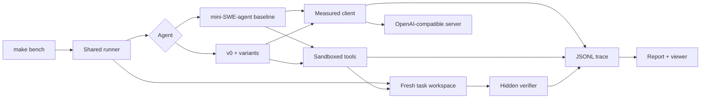

# small-model-harness

[](https://github.com/latewatt/small-model-harness/actions/workflows/ci.yml)


A sandboxed, fully measured benchmark rig for **coding agents running on small local models**, plus a minimal agent you can take apart one change at a time.

Most agent harnesses are tuned for frontier models behind an API. This project asks a narrower question: *on a 4B model running on a laptop, which harness changes actually make the agent solve more tasks?* Every run records the model digest, suite hash, source hash, budgets, tokens and a full trace, and success is decided only by a hidden verifier that runs after the agent stops.

## What I found

All runs use `qwen3.5:4b` (Q4_K_M) through a local OpenAI-compatible server on a 16 GB Apple Silicon laptop, on the 10-task `mini-v1` suite, with the same seed, sampling settings and step/time budgets.

| Configuration | Passed | Malformed actions | Input / output tokens |
|---|---:|---:|---:|
| mini-SWE-agent 2.4.6 (reference baseline) | **5/10** | 5 | 403,614 / 34,099 |
| v0 (my original agent) | 0/10 | 32 | 35,324 / 4,490 |
| v0 + constrained JSON actions | 2/10 | **1** | 82,172 / 7,601 |
| v0 + targeted repair feedback | 1/10 | 27 | 42,539 / 4,144 |
| v0 + aligned read/patch views | 0/10 | 28 | 35,401 / 5,376 |
| v0 + requirement self-checks | 0/10 | 34 | 42,930 / 3,911 |
| v0 + file-version loop guard | 0/10 | 32 | 45,320 / 5,251 |
| constrained + aligned + versions | 3/10 | 0 | 83,883 / 8,876 |
| … + requirement self-checks | 2/10 | 0 | 184,595 / 17,596 |
| … + targeted repair | 4/10 | 0 | 189,478 / 14,227 |

**Valid actions are only the start.** Constrained decoding took malformed actions from 32 to 1 and removed every "ran out of format retries" exit, but the best combination still solved fewer tasks than the plain reference agent. Passing self-tests did not mean passing the hidden grader, and the final configuration's extra repair branch never fired, so its score change can't be credited to it. The full ablation table, failure taxonomy and per-task numbers are in [RESULTS.md](RESULTS.md); the short version is in [WRITEUP.md](WRITEUP.md).

These are development-suite results on fixtures written for this project: one attempt per task, no held-out set, **not** Terminal-Bench scores.

## Features

- **Shared measurement rig.** Every agent gets the same fresh workspace, client, budgets and grader. Tokens are provider-reported, never estimated, and failed attempts are counted.
- **Hidden verifiers.** Each task ships a broken starting tree, an oracle solution and a verifier the agent can't read. `make test` checks that every broken tree fails and every oracle passes.
- **Real sandboxing, no unsafe fallback.** Generated shell commands run under macOS Seatbelt or Linux bubblewrap: no network, writes only inside the task workspace, CPU/file/output limits, and timeouts that kill background children.
- **Traces you can read.** Every request, response, tool call, error and grade goes to an append-only JSONL trace, with a standalone HTML viewer (no server, no third-party assets).
- **Preregistered ablations.** The Phase 2 experiment manifest fixes the model digest, suite hash and core source hash before scoring; the runner refuses to mix revisions.
- **Any OpenAI-compatible endpoint.** Ollama, llama.cpp `llama-server`, LM Studio, vLLM, or a hosted API with your own key.

## Quickstart

Requires Python 3.12 and [uv](https://docs.astral.sh/uv/). On Linux, install `bubblewrap`.

```sh
make setup        # pinned environment in .venv
make test         # offline: sandbox, protocol, graders, reporting
```

Run a benchmark against any OpenAI-compatible server:

```sh
make bench BASE_URL=http://127.0.0.1:8080/v1 MODEL=your-model AGENT=v0 SUBSET=mini10
make report       # regenerate RESULTS.md from saved runs
make view         # open the trace viewer
```

On macOS, `make serve` and `make pull MODEL=qwen3.5:4b-q4_K_M` start and manage a project-owned Ollama instance on port 11435 with its weights and caches kept inside the repo.

Each `make bench` creates a run directory under `runs/` with `run.json` (identity, config, hashes, metrics), `results.csv`, per-task traces, the submitted files and a frozen copy of the agent source.

## How it works



| Path | What it is |
|---|---|
| `harness/bench.py` | Runner: workspaces, warm-up, agent, grading, aggregation |
| `harness/client.py` | Chat-completions transport with deadlines, bounded retries and real usage |
| `harness/sandbox.py` | Seatbelt / bubblewrap boundary and safe read/patch/search tools |
| `harness/v0.py` | The small agent loop: one JSON action per step |
| `harness/variants.py` | The five independent Phase 2 changes and their combinations |
| `harness/report.py` | Cross-checks artifacts and regenerates `RESULTS.md` |
| `suites/mini-v1/` | 10 tasks: CSV money totals, config merging, intervals, toposort, SQL, a broken package, … |

Design notes and the extension points are in [docs/design.md](docs/design.md).

## Reproducing the ablation

The Phase 2 runs were scored with the core source frozen at the [`phase2-results`](https://github.com/latewatt/small-model-harness/tree/phase2-results) tag. Later commits (Linux sandbox support) change that core, so `make ablate` on `main` fails closed by design. To reproduce:

```sh
git checkout phase2-results
make setup && make serve && make pull MODEL=qwen3.5:4b-q4_K_M
make ablate
```

## Terminal-Bench

`make terminal-plan SUBSET=tb2-fast15` prints a pinned Harbor command for a 15-task Terminal-Bench 2.0 subset using the official Terminus 2 agent. It needs Docker and has not been run yet. See [docs/terminal-bench.md](docs/terminal-bench.md) for the benchmark versions, the subset choice and published small-model results.

## Limitations

- Ten tasks, one attempt each, one model, one machine. Differences of one or two tasks are within noise.
- The combination was chosen on the same suite it was scored on.
- The suite was authored for this project and is far easier than Terminal-Bench.
- The sandbox is development containment for trusted fixtures, not an isolation boundary for hostile code.

## Roadmap

- [ ] Run the Terminal-Bench 2.0 subset through Harbor
- [ ] A held-out task suite to validate the chosen configuration
- [ ] More small models and servers in the same matrix
- [ ] A Harbor environment adapter so v0 can run on real benchmark containers

## License

MIT. Models and dependencies keep their own licenses.
