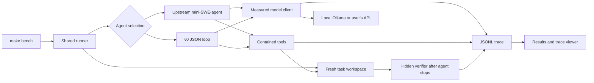

# Extending the harness

This is a local-first measurement rig and a deliberately small agent. It does not train a model. The same task setup, OpenAI-compatible client, process containment, hidden grader and accounting code surround both agents. The local mini-suite is the working backend; a Terminal-Bench route via Harbor is documented in [terminal-bench.md](terminal-bench.md).

## Why Python

The benchmark ecosystem and the reference agent already use Python. Python lets the project use the actual upstream mini-SWE-agent loop without porting it, while its standard library supplies HTTP, JSON, subprocesses, filesystem operations and the test fixtures. The v0 runtime itself does not need an agent framework. A pinned environment keeps upstream changes from silently changing a baseline.

## Data flow and ownership



| Module | Responsibility | Extension point |
|---|---|---|
| `harness/bench.py` | Load subset, snapshot source, create workspaces, warm model, run agent, grade, aggregate | Add a backend without changing graders or accounting |
| `harness/client.py` | Chat-completions transport, deadlines, retry policy, actual usage | Add provider-specific options explicitly; preserve raw responses |
| `harness/baseline.py` | Adapter around pinned upstream reference | Keep reference behavior separate from experiments |
| `harness/v0.py` | Prompt, tool loop, repair feedback, memory, step/repetition limits | Main location for future harness experiments |
| `harness/variants.py` | Independent Phase 2 switches and their loop | Isolate a change before composing features |
| `harness/experiment.py` | Preregistered model/suite/budget/source invariants | Define a new experiment without rewriting prior evidence |
| `harness/protocol.py` | Validate one action with exact keys/types | Add a tool schema before adding dispatch |
| `harness/sandbox.py` | Process boundary (macOS Seatbelt or Linux bubblewrap) and safe file tools | Implement the same methods for a container environment |
| `harness/trace.py` | Append-only event stream | Add versioned events; never place credentials in data |
| `harness/report.py` | Check artifact consistency, derive `RESULTS.md` | Extend metrics from trace evidence, not guesses |
| `harness/viewer.py` | Standalone HTML inspection | Add filtering/views without changing inference |
| `harness/server.py` | Own one Ollama process and its files (macOS) | Add a separately owned MLX/LM Studio backend |

## Baseline contract

The reference is **mini-SWE-agent 2.4.6**, specifically `DefaultAgent` with the official `default.yaml` prompts and `LitellmTextbasedModel`. This is its supported text-action variant, not the newer recommended native function-call mode and not Terminal-Bench's Terminus 2 agent.

The adapter replaces HTTP transport with the shared measured client and replaces unconstrained local shell execution with the shared sandbox. Upstream action parsing, observation formatting, format-error handling, step control and completion-sentinel detection remain intact. Cost tracking is disabled; the internal zero cost required by upstream is not reported as a measured dollar cost. The upstream trajectory is retained alongside the common JSONL trace.

Both agents share model, sampling settings, output cap, task order, initial files, step count, request timeout, shell timeout and verifier. Their prompts, tool interfaces and context policies differ. This compares whole harness configurations; it does not isolate one component's causal effect. A model temperature of zero and a fixed seed improve repeatability but do not guarantee bit-identical hardware/backend execution.

Tool observations also include runtime fields such as `wall_s`, and fresh workspaces can expose different timestamps or paths. These can change later prompts even when the first request is identical. Phase 2 retained that original behavior to keep the implementations comparable; a replay audit is saved in `research/phase2-replay-check.json`. Single attempts cannot distinguish every feature effect from trajectory variation.

## v0 action protocol

The model emits a single JSON object:

```json
{"tool":"patch","args":{"path":"module.py","old":"return 0","new":"return value"}}
```

Supported actions are `shell`, `read`, `patch`, `search` and `finish`. Unknown tools, extra fields, missing fields, duplicate JSON keys, wrong primitive types, non-finite JSON constants, multiple actions and incomplete output are rejected before dispatch. A complete surrounding JSON Markdown fence is stripped as a safe format repair. Otherwise, the model receives an error with valid envelope examples and must retry. We do not execute Python literals, repair guessed quotes, reinterpret arbitrary commands or silently fix code semantics.

Every attempt consumes a step, including malformed replies. Three consecutive invalid replies end the task. The fourth occurrence of an identical action ends the task; the third receives a warning. This is deliberately basic: it counts identical actions across the whole task, so repeated legitimate reads can hit the limit. A future progress-aware detector should consider file changes and observations.

An output with `finish_reason=length` is rejected by v0 even if it happens to contain parseable JSON. That prevents execution of a potentially cut-off action. The tradeoff is that a large edit can consume the repair budget; adaptive chunked edits are a future experiment.

## Tools and containment

`shell` starts a fresh noninteractive bash process in the task directory. It has a wall timeout, output cap, CPU/file-size limits, a minimal environment and no task network access. On timeout or output overflow, the process group is killed; background children in that group are cleaned up after ordinary completion too. Directory changes do not persist across calls.

`read` returns numbered lines, rejects traversal and symlink escapes, and refuses oversized files. `patch` performs exactly one literal replacement; ambiguous/missing matches fail without mutation. An empty `old` is allowed only for a new file. Writes use an exclusive temporary file and atomic replacement. `search` uses bounded literal recursive grep; it does not interpret the query as regex or shell syntax.

macOS `sandbox-exec` denies writes except inside the task workspace, denies network operations, and denies user-data reads except the task and Python virtual environment. Hidden verifier and oracle files are outside that scope. The verifier runs only after the agent stops, with read access to its own script. The submitted tree is copied before grading creates additional inputs.

This is development containment for the trusted authored suite. Seatbelt is not a portable hostile-code isolation system; OS services/process metadata remain accessible, disowned process tricks are outside its guarantee, and local verifiers are not a leaderboard security boundary. Use Harbor's containers/cloud sandboxes for real external benchmark tasks. The local runner fails closed on platforms without a supported backend.

On Linux the same contract is implemented with bubblewrap: `--unshare-all` gives the command fresh network (loopback only), PID, IPC and UTS namespaces; system directories, the project interpreter and explicitly readable files are bind-mounted read-only; the workspace is the only writable mount, and the rest of the root is remounted read-only. Because the command runs in its own PID namespace with `--die-with-parent`, killing the bwrap process on a timeout kills every child, including background ones. GitHub-hosted Ubuntu runners need unprivileged user namespaces enabled (see `.github/workflows/ci.yml`).

## Context and observations

Raw tool output is retained up to the subprocess cap. v0 sends only a head/tail excerpt bounded to 2400 UTF-8 bytes and explicitly marks omissions. It maintains a 6000-byte conversation guard including per-message overhead. System prompt and task stay intact. On overflow, it evicts old activity and inserts a bounded extractive ledger containing snippets of recent evicted actions/observations.

This is deterministic summarization, not an extra model call. It has no unrecorded inference cost, but it is lossy and can omit important outcomes. The byte guard is a conservative practical control, not an exact model tokenizer or a proof about every provider's chat template. The local server is configured for an 8192-token context. The actual prompt token counts come exclusively from provider responses. Baseline context handling remains upstream, including its own output truncation.

## Measurement semantics

- **Pass:** the hidden verifier exits successfully and prints its success marker. Agent claims of completion do not affect scoring. A correct solution can pass even if the agent reaches a step limit before submitting.
- **Tokens:** sum `usage.prompt_tokens` and `usage.completion_tokens` across actual API responses, including malformed-action attempts. Repeated/cached prompt tokens are included as the provider reports them. Missing usage or an unresolved HTTP failure makes the exact total unknown; observed partial counts remain in the raw records.
- **Time:** monotonic elapsed time. Per-task wall includes agent construction, requests, tools, submission copying and grading. Warm-up has its own trace and accounting. Job wall includes warm-up; downloads are outside the run.
- **Attempts:** sequential task execution; no pass@k or best-of pooling. A file lock prevents concurrent benchmark processes from competing for the owned endpoint.
- **Reproducibility:** run metadata includes model digest, suite hash, source snapshot/hash, endpoint, platform, sampling options and budgets. Scores are regenerated from raw records, with consistency checks.

API keys are read only from environment variables and are never copied into request trace payloads. The task subprocess environment excludes them. User-provided source or tool output can itself contain sensitive text, so inspect evidence before publishing it.

## Adding work

To add a local task, create a new task directory under `suites/mini-v1` with `initial/`, `instruction.md`, `verify.py` and test-only `oracle/`. Add it to the manifest and a new subset. Verify that the initial state fails and the oracle passes. Do not modify a scored suite in place: create a new suite version and keep the old one for comparisons.

To add a tool, update `SCHEMA`, the prompt and dispatch, then test rejection before execution, path/argument boundaries and failure feedback. To test context policy, change only compaction while keeping all other settings fixed and run a new evidence directory. To add an external provider, set `BASE_URL`, `MODEL` and `HARNESS_API_KEY`; do not embed a key in a URL or file.

To port v0 to Harbor, implement a tool adapter backed by `BaseEnvironment.exec`, run the synchronous loop off the event loop, expose the container's real OS/working-directory contract in the prompt, and fill `AgentContext` usage from the same client. Harbor's verifier must own grading. This adapter is not implemented yet. The supplied Terminal-Bench planner uses the official Terminus 2 reference; the current end-to-end baseline/v0 backend is the authorized local fallback.

## Tests and deliberate limits

Tests cover strict parsing, safe repairs, exhausted budgets, token accounting, uncertain usage, task isolation, shell time/output limits, patch integrity, context bounds and both sides of every grader. Network-free tests never substitute for scored real-model runs. The local fixture set is small, synthetic and visible in the repository; it is for debugging and iteration, not proof of generalization. Improve on it, then freeze a held-out suite and obtain the official Terminal-Bench measurement.

## Phase 2: independent ablations

The original `run_v0` remains unchanged. `AGENT=v0` and the upstream baseline still use their original paths. Phase 2 agents use `run_variant`, with a frozen implementation and explicit feature flags recorded in each run. An empty feature set delegates to the original loop. The only shared transport extension is an optional `response_format` argument; requests without it retain their original payload fields.

| Agent | Sole enabled change | Deliberately retained behavior |
|---|---|---|
| `v0-constrained` | Endpoint JSON-schema action decoding | Original prompt, tools, repair, context and repetition policy |
| `v0-repair` | Tool-specific corrective feedback that changes on identical invalid replies | Unconstrained decoding and the original tools/budgets |
| `v0-aligned` | Raw code with separate range metadata; precommit Python syntax check | Original unconstrained protocol and repetition policy |
| `v0-requirements` | Task-quote requirements artifact, self-tests and a finish gate | Original tool interface and fixed inference/step budgets |
| `v0-versions` | Repetition signatures include file versions | Original protocol, prompt and tools |

Combinations use explicit names such as `combo-constrained-aligned-versions`. Every enabled feature must have been measured alone first. The implementation is frozen before the single-change runs; the combination changes only configuration. Selecting a combination from this suite is development-set optimization. It is not evidence of held-out generalization, and interactions mean that gains from individual changes cannot simply be added.

### Constrained actions

The response format is a JSON-schema union of the existing actions. Each branch fixes the tool name, its required/optional arguments, primitive types, numeric bounds and prohibition on extra keys. Using structured JSON preserves the existing action representation and tool dispatch, making the intervention narrower than replacing the conversation with a native tool-call protocol. Ollama documents this through `response_format`. [Structured-output documentation](https://docs.ollama.com/capabilities/structured-outputs), [compatibility documentation](https://docs.ollama.com/api/openai-compatibility).

Actual endpoint probes mattered: a NUL-excluding string regex caused silent unconstrained output on this installation. The scored schema removes that keyword and retains the verified subset. The local parser still checks NULs, duplicate keys, all argument rules and the output finish reason. A token limit can interrupt a constrained object; it is rejected and counted, never silently completed. Synthetic probe traces are saved separately and are not benchmark attempts.

### Targeted repair

Malformed output is inspected only to infer which tool needs feedback. A decoded prefix is never dispatched. The response names the exact validation error, shows that tool's allowed fields and supplies one valid example, preserving valid short arguments where possible. Identical invalid replies trigger a different corrective instruction. All retries still consume ordinary steps, and the original consecutive-format-error ceiling remains unchanged.

### Read/patch alignment

`AlignedSandbox.read` returns a `code` field including line breaks and separate start/end/total-line metadata. Like the existing patch method, Python text reading normalizes newline conventions. Display labels cannot accidentally become part of a copied patch. For a Python patch, the proposed full file is compiled without execution before the original atomic replacement method is called. Syntax rejection leaves the old file untouched, including when creating a new file. Non-Python patches retain exact-match behavior. Shell writes remain possible and are not covered by this patch-specific precommit check; this is an ablation of the explicit edit tool, not a filesystem interceptor.

### Requirement checks

The agent is instructed to create `.agent-requirements.json` before implementation, quoting the task's exact requirements and describing a self-test for each. It also writes `.agent-selftest.py`. On `finish`, the harness checks artifact size/shape, verifies that the quoted text occurs in the original task, requires Python assertion syntax, and runs the tests in the sandbox. A failed gate returns feedback and consumes the current step; no extra model call is hidden outside the budget.

Quote matching prevents wholly invented requirement text, but it does not prove coverage or that an assertion correctly interprets the quote. A model can still write weak, irrelevant or contradictory tests. The independent hidden grader remains the scoring authority. Gate activity and outcomes are separate trace events.

### File-version repetition

The counter key combines the action with a fingerprint of file metadata: relative path, inode, modification time and size. Reads/patches use their target; shell/search use workspace files. Symlinks are not traversed, and temporary command directories and Python caches are excluded. Re-reading a changed file starts a new version count; repeating the same action against the same version still warns and stops at the original limits. Rewrites of identical contents can appear as new versions, so this is a practical progress proxy, not proof that an edit was useful.

### Experiment integrity and reproduction

`research/phase2-experiment.json` records the original model digest, suite hash, endpoint, sampling settings and budgets, plus the frozen Phase 2 core hash and combination-selection policy. The runner rejects drift before scoring. Each run snapshots the implementation, records its feature set and logs the actual request payload. The report verifies feature declarations and structured-output activation as well as the original accounting checks. Unit fixtures for these checks are never placed in the scored run collection.

```sh
make ablate
make bench AGENT=v0-constrained SUBSET=mini10 TASK_TIMEOUT=600
make report
make test
```

`make ablate` runs all preregistered single changes sequentially and preserves its console log. Re-running it creates new attempts; the report includes them all. To launch a chosen combination, pass its explicit name to `scripts/run_ablation.py`, which applies the fixed settings from the manifest. Do not overwrite the manifest to hide drift. Create a new experiment/revision when changing code, and retain the old evidence and source snapshots.
